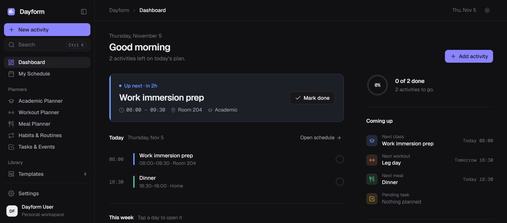
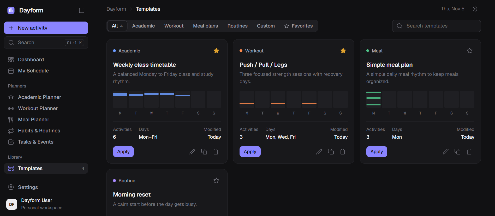
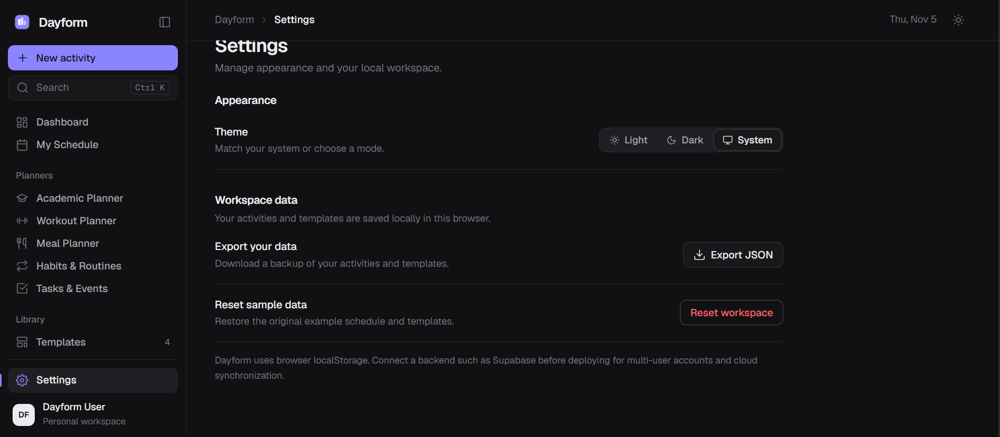

# 📅 DayForm — Personal Schedule and Lifestyle Planner


A **modern, web-based personal scheduling and lifestyle planning application** designed to help users organize their time, build consistent routines, and manage different aspects of everyday life.

DayForm brings academic schedules, workout plans, meal schedules, daily routines, habits, and personal tasks together in one organized workspace.

With a unified calendar, dedicated weekly timetable, customizable schedule templates, and schedule image export, DayForm helps users turn their plans into practical routines.

---

# 🖥️ Application Preview

<table>
  <tr>
    <td align="center">
      
      <br>
      <b>Personal Dashboard</b>
    </td>
    <td align="center">
      
      <br>
      <b>Unified Schedule</b>
    </td>
  </tr>
  <tr>
    <td align="center" colspan="2">
      
      <br>
      <b>Schedule Templates</b>
    </td>
  </tr>
  <tr>
    <td align="center" colspan="2">
      
      <br>
      <b>Personalization and Settings</b>
    </td>
  </tr>
</table>

---

# 📌 Overview

Managing different responsibilities can become challenging when schedules are scattered across separate applications, documents, or personal notes.

Students may need to manage class timetables and study sessions, while individuals may also want to organize workouts, meals, habits, and personal activities. Keeping these plans separate can make it difficult to see how they fit together.

**DayForm was designed to bring these schedules into one centralized planning experience.**

Users can organize activities by category, view their plans through daily, weekly, or monthly layouts, and create reusable templates for recurring routines.

The application emphasizes a clear overview of the week, allowing users to identify busy days, organize available time, and maintain a more balanced routine.

DayForm is designed for students, fitness enthusiasts, busy individuals, and anyone who wants a more organized approach to managing their time.

---

# ✨ Features

- 📊 **Personal Dashboard** — View today's activities, upcoming events, and an overview of your schedule.
- 🗓️ **Unified Schedule** — Organize academic, fitness, meal, routine, and personal activities in one workspace.
- 📆 **Daily, Weekly, and Monthly Views** — Switch between detailed daily timelines, full weekly timetables, and monthly calendar layouts.
- 🎓 **Academic Planner** — Organize subjects, class times, instructors, rooms, and recurring academic schedules.
- 🏋️ **Workout Planner** — Build exercise routines with customizable exercise types, sets, repetitions, duration, resistance, and variations.
- 🔁 **Workout Variations** — Organize routines such as Full Body, Upper/Lower, Push/Pull/Legs, cardio, mobility, and recovery sessions.
- 🍽️ **Meal Planner** — Schedule meals, organize food items, and record dietary preferences and nutrition estimates.
- 🥗 **Dietary Preferences** — Organize meal plans around preferences such as balanced, high-protein, vegetarian, vegan, and custom diets.
- 🌅 **Daily Routine Builder** — Plan recurring activities such as morning routines, study sessions, personal care, and evening routines.
- ✅ **Habit Tracker** — Track completed habits and monitor consistency over time.
- 📝 **Tasks and Events** — Manage assignments, deadlines, appointments, reminders, and personal activities.
- 🧩 **Schedule Templates** — Save, duplicate, and reuse class timetables, workout routines, meal plans, and personal schedules.
- 🖼️ **Schedule Image Export** — Export selected schedules as shareable image files.
- 🖨️ **Print-Friendly Schedules** — Prepare schedules for printing or offline reference.
- ⚠️ **Schedule Conflict Detection** — Identify overlapping activities and help users review scheduling conflicts.
- 🔎 **Activity Filtering** — Filter schedules by category and find specific activities more easily.
- 🌓 **Appearance Settings** — Customize available interface preferences and appearance modes.
- 📱 **Responsive Interface** — Designed for desktop, tablet, and mobile screen sizes.

---

# 🛠️ Technologies Used

> Update this section if the project's implemented technology stack differs from the list below.

## Frontend Development

- React
- TypeScript
- HTML5
- CSS3
- Tailwind CSS

## Development and Build Tools

- Vite
- npm
- Node.js

## Interface and Interaction

- Lucide Icons
- Responsive design principles
- Reusable React components

## Schedule and Date Handling

- Calendar and timeline components
- Date and time utilities
- Recurring schedule logic

## Development Tools

- Visual Studio Code
- Git
- GitHub
- Modern Web Browser

---

# 🚀 Installation and Setup

Follow these instructions to install and run DayForm locally.

## Prerequisites

Before installing the project, ensure that the following tools are available:

- [Node.js](https://nodejs.org/)
- npm, included with Node.js
- [Git](https://git-scm.com/), optional for cloning the repository
- Visual Studio Code or another code editor

## 1. Clone the Repository

```bash
git clone https://github.com/rheillunio2-byte/DayForm.git
```

## 2. Navigate to the Project Folder

```bash
cd DayForm
```

## 3. Open the Project in Visual Studio Code

```bash
code .
```

Alternatively, open Visual Studio Code manually and select the DayForm project folder.

## 4. Install Dependencies

```bash
npm install
```

If you are using Windows PowerShell and encounter an execution-policy error when running `npm`, use:

```powershell
npm.cmd install
```

## 5. Run the Application Locally

Start the Vite development server:

```bash
npm run dev
```

Alternatively, on Windows PowerShell:

```powershell
npm.cmd run dev
```

## 6. Open DayForm in Your Browser

Once the development server has started, open the local URL displayed in your terminal.

The default Vite development address is:

```text
http://localhost:5173/
```

**Note:** Some features may require additional configuration depending on the project's backend, database, or external integrations.

---

# 📖 How to Use DayForm

## 1. Dashboard

The Dashboard provides a convenient overview of your daily activities.

Use it to review upcoming events, check your progress, and quickly access your schedules.

## 2. My Schedule

The My Schedule section brings your activities together in one unified view.

### Daily View

Use the daily view to review the detailed timeline of a selected day.

### Weekly View

Use the weekly view to see your entire week at a glance.

This layout is particularly useful for:

- Reviewing your class timetable
- Planning workout days
- Organizing meal times
- Scheduling study sessions
- Identifying busy days and available time

### Monthly View

Use the monthly view to review activities across an entire month and navigate between dates.

## 3. Academic Planner

Use the Academic Planner to organize class schedules and academic responsibilities.

You can record information such as subject names, class times, instructors, rooms, and recurring class days.

## 4. Workout Planner

Use the Workout Planner to create and organize exercise routines.

Customize your workout schedules by selecting exercise types, assigning workout days, recording sets and repetitions, and including exercise variations that fit your routine.

## 5. Meal Planner

Use the Meal Planner to organize meals throughout the day or week.

You can plan meal times, record food items, and organize dietary preferences. Nutrition information should be treated as an estimate unless supported by verified data.

## 6. Habits and Routines

Use this section to plan recurring personal activities and track your consistency.

Examples include studying, reading, exercise, personal care, and morning or evening routines.

## 7. Tasks and Events

Use Tasks and Events to manage deadlines, appointments, reminders, and activities that do not belong to another schedule category.

## 8. Schedule Templates

Save schedules that you use regularly so you can reuse or modify them instead of rebuilding them from scratch.

Templates can be useful for recurring class timetables, workout splits, meal plans, and weekly routines.

## 9. Exporting a Schedule

Use the schedule export feature to create a shareable image of your selected schedule.

Depending on the available export options, you may be able to export a daily, weekly, or monthly schedule and customize its appearance before downloading.

---

# 📂 Project Structure

```text
DayForm/
│
├── public/
│   └── images/
│       ├── Dashboard.PNG
│       ├── My Schedule.PNG
│       ├── Templates.PNG
│       └── Settings.PNG
│
├── src/
│
├── .env.example
├── .gitignore
├── CONTRIBUTING.md
├── LICENSE
├── README.md
├── index.html
├── package.json
└── vite.config.ts
```

*The structure may vary depending on the current implementation.*

---

# ⚠️ Important Notes

- DayForm is intended to help users organize their schedules and routines. It is not a substitute for professional medical, fitness, or dietary advice.
- Nutrition information should be treated as estimated unless verified through a reliable source.
- Users should choose exercises and routines appropriate for their abilities and needs.
- Some advanced features may depend on backend services or additional configuration.
- Schedule exports should be reviewed before printing or sharing to ensure that the information is displayed correctly.

---

# 🔮 Future Improvements

Potential future enhancements include:

- 📤 Calendar import and export
- 🔔 Notifications and reminders
- 🧠 Optional AI-assisted schedule suggestions
- 📈 Weekly productivity summaries
- 🏋️ Workout progress tracking
- 🛒 Grocery list generation from meal plans
- 🔄 Schedule synchronization across devices
- ☁️ Cloud backup and restore
- 📊 More detailed habit and routine analytics
- 🎨 Additional schedule themes and export customization

These are potential improvements and may not be available in the current version.

---

# 🤝 Contributing

Contributions, suggestions, bug reports, and documentation improvements are welcome.

Please read [CONTRIBUTING.md](./CONTRIBUTING.md) for guidelines on setting up the development environment, following coding standards, reporting bugs, and submitting pull requests.

---

# 📄 License

DayForm is distributed under the **MIT License**.

See the [MIT License](https://github.com/rheillunio2-byte/DayForm?tab=MIT-1-ov-file) for details.

---

# 👨‍💻 Developer

**Rheil Evans T. Lunio**

GitHub: [@rheillunio2-byte](https://github.com/rheillunio2-byte)

---

**DayForm — Plan your time. Build your routine. Shape your day.**